# Adding a game

[← KairoX86](../README.md)

KairoX86 has no game catalog: every game is a PC you set up, kept as a machine folder in your games
folder (its `86box.cfg`, its disks and `nvr/`). These are the steps, in the order you take them. The
screenshots are from an RG DS: its upper screen shows the library and the game, its lower screen a
game's details and settings. On a one-screen device the same pages open on the one screen.

## 1. Make the machine

Menu › Manage library › New game, then one of the presets: IBM PC XT, 486 DOS PC or Pentium
Windows 9x PC. Type its name and tap Create.

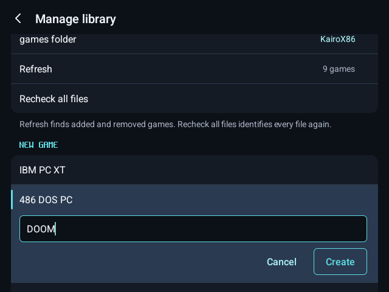

KairoX86 makes the machine's folder in your games folder, set up as the preset, and lists it in the
library at once.

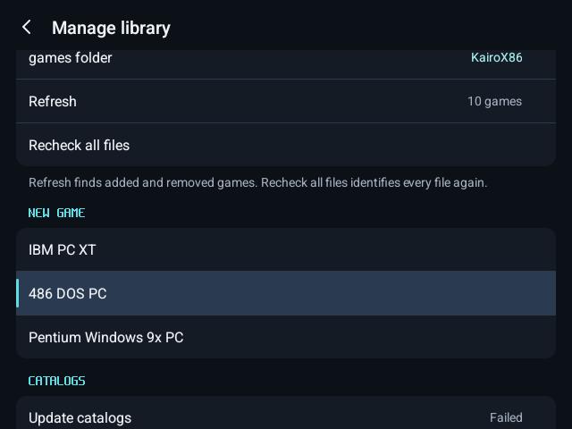

## 2. Put its disks in its folder

Copy the game's disk images (floppy images such as `.img`, CD images such as `.iso` or `.cue`,
hard disk images such as `.vhd`) into the machine's folder with a file manager, then Menu › Refresh.
A machine runs its disks where they are, so they stay in its folder; what the game writes to them
stays there too.

Disks are not grouped by name. A machine's disks are simply the files in its folder. Disks in other
machines' folders, or loose in the games folder, are on every drive's **Other** page. **Choose
file…** takes one from anywhere on the device, for one run.

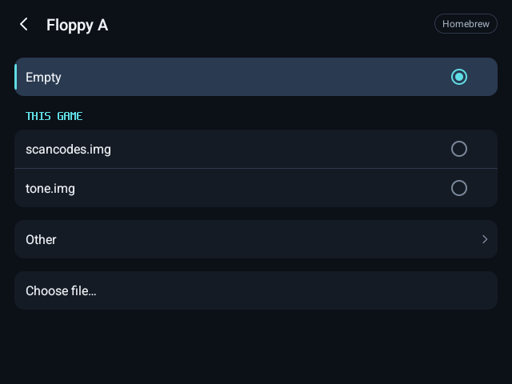

## 3. Choose the disk it starts from

Play. A new machine has no disk in its drives, so its BIOS asks for one:

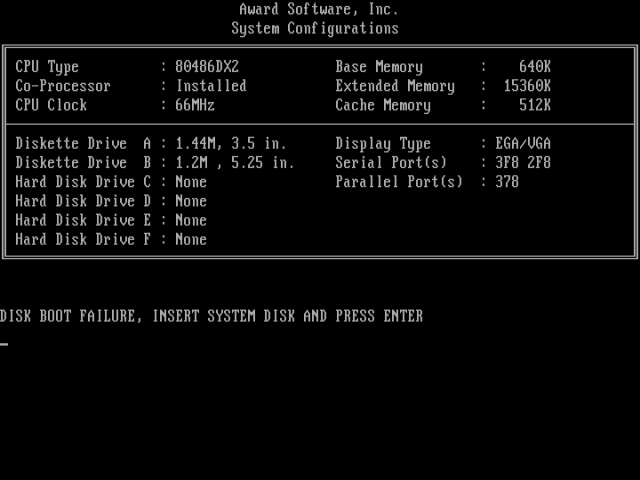

Open the menu (Menu button, Back, or a swipe in from the left edge), then Disks › Floppy A, and pick
the game's boot disk. Close the menu and press Enter, as the BIOS asks: the machine starts from it.

When the game ends, KairoX86 writes the disk into the machine's `86box.cfg`, so it starts from that
disk from then on.

### A hard disk

A machine with a hard disk image: put the image in the folder and in the machine's `86box.cfg`, then
enter the BIOS's own setup as the PC asks (Del at power-on). Run IDE HDD AUTO DETECTION, and if the
hard disk has no system of its own yet, set the Boot Sequence to A, C so the PC starts from the
floppy. Save with F10. The BIOS settings are the machine's `nvr/`, written when the game ends: make
a change and restart within the same run.

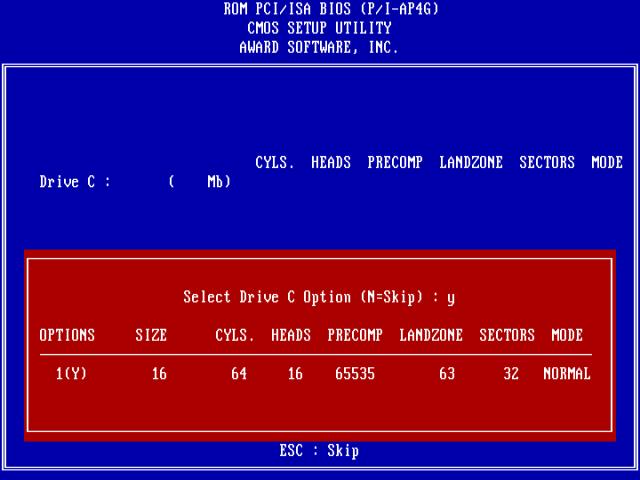

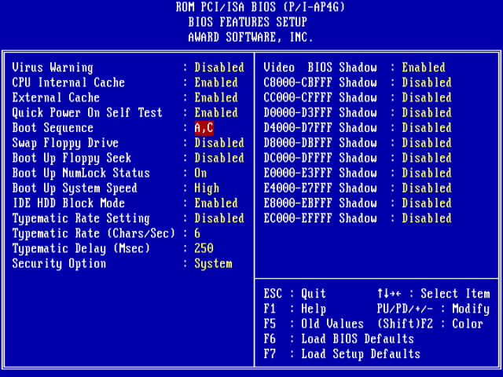

## 4. Firmware

The XT preset starts on GLaBIOS, the free firmware KairoX86 ships. The 486 and Pentium presets
start on their boards' own BIOS from 86Box's firmware set, which you import once from its folder:
at the first start, or on Menu › Machine › Import all from a folder…. Each file is found by its
content, whatever its name.

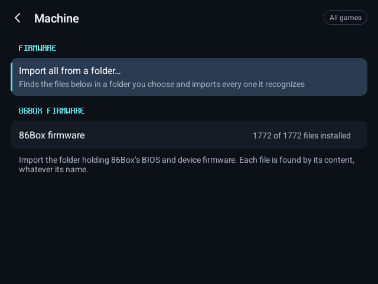

## 5. Name it

Game settings › Library › Title, type its name, Save. Box art and Screenshot take your own images.

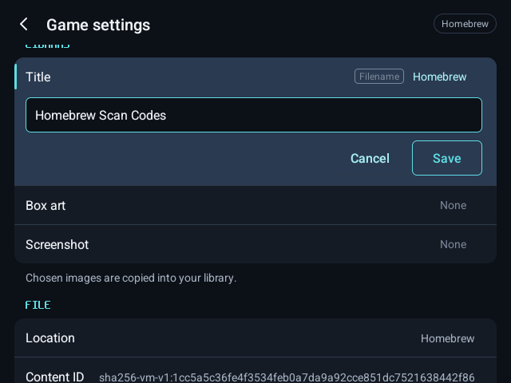

## 6. Set it up

Game settings hold everything that is this game's alone:
- the machine: its board, processor, memory, cards and their own options, kept in its `86box.cfg`;
- startup commands, the lines typed at its DOS prompt to start the game;
- its controls: button mapping, Screen tap, Mouse touch, and what the second screen starts with;
- its display anchors.

Reset all game settings clears the app's settings for it and nothing else.

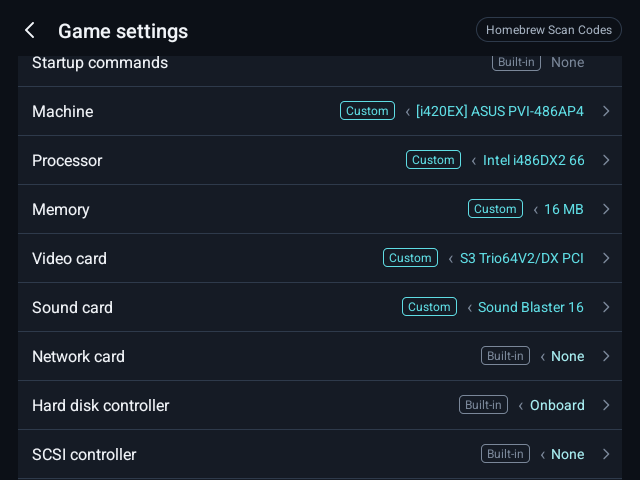

## 7. Test it, and swap disks

A game that asks for another disk: Menu › Disks › Floppy A (or B, or CD-ROM), then pick the disk.
It goes in at once, with the machine running.

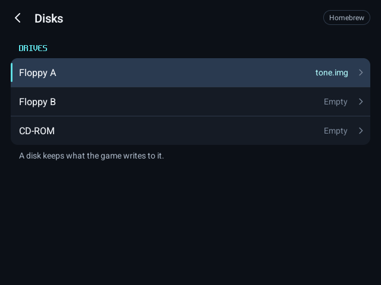

## 8. It is kept

The machine, its name, its disks and its settings are kept when you close and reopen KairoX86 and
when you refresh the library.

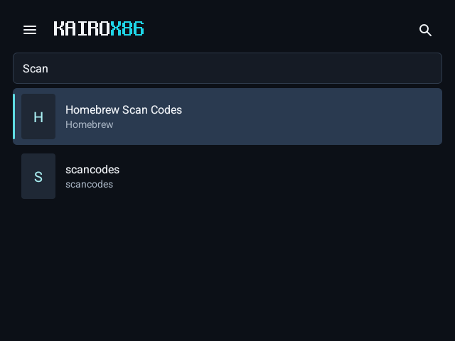

What the game writes stays on its disks, in its folder:

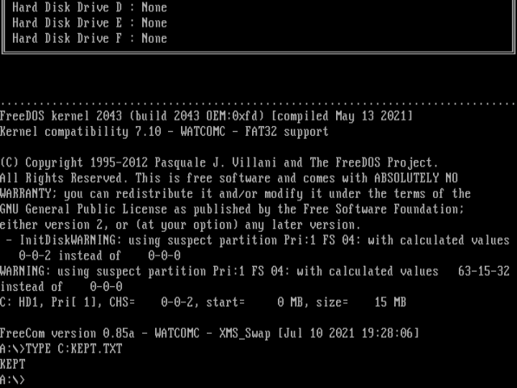

86Box machines have no save states yet.
