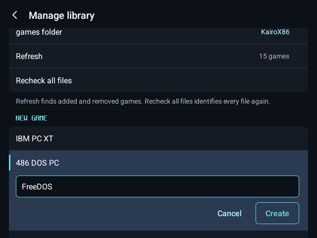
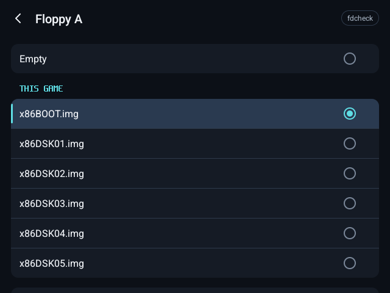
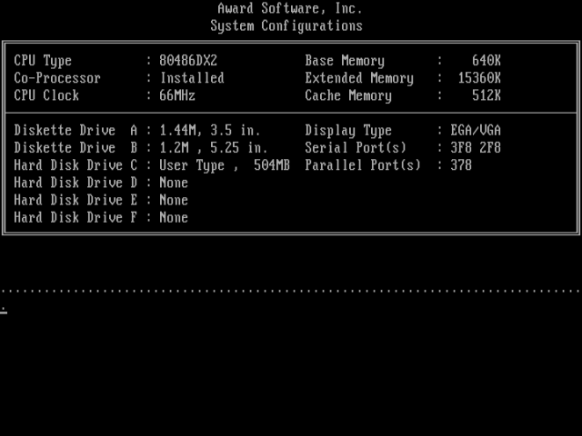
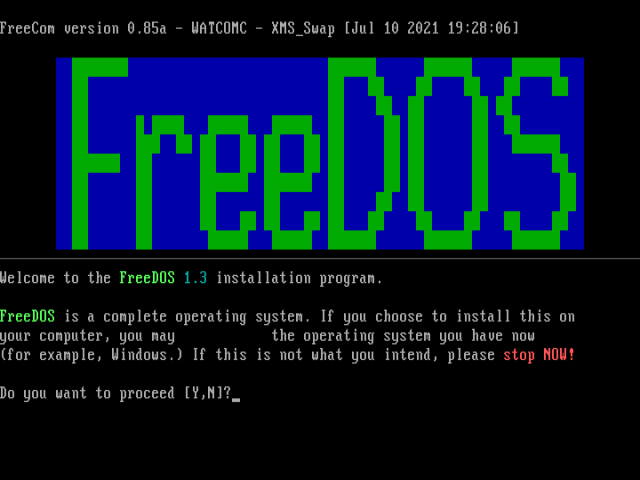
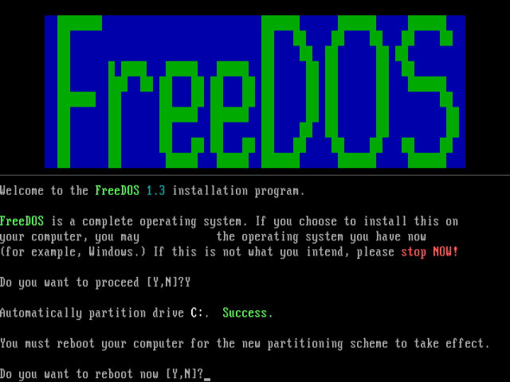
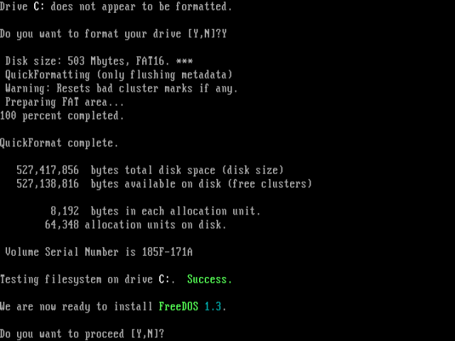
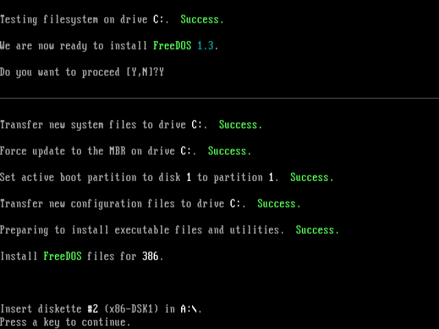
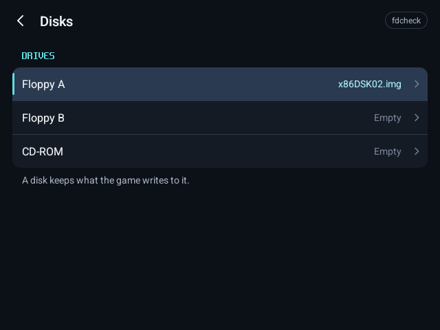
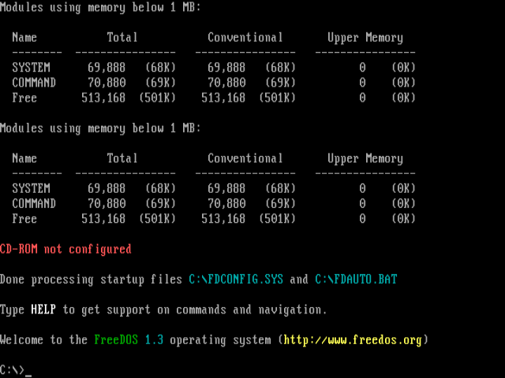
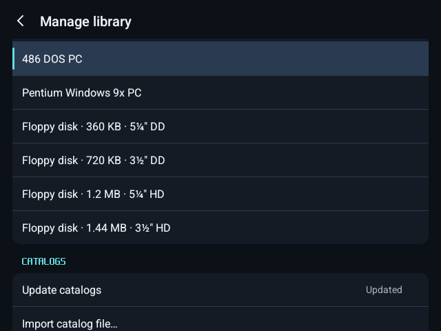

# Creating a new game on a blank disk

[← KairoX86](../README.md)

A new PC in KairoX86 comes with a blank hard disk. You install DOS and your games onto it from
their floppies or CD, as on a real PC, and the machine then starts from its own disk. These are the
steps, in the order you take them. The screenshots are from an RG DS: its upper screen shows the
library and the PC, its lower screen a game's details and settings. On a one-screen device the same
pages open on the one screen.

The example installs FreeDOS 1.3 from its Floppy Edition (six 1.44 MB floppy images, free from
freedos.org), then a game from its floppy. Any DOS or Windows 9x installer goes the same way.

## 1. Create the PC

Menu › Manage library › New game, then 486 DOS PC (or Pentium Windows 9x PC). Type its name and
tap Create.

KairoX86 makes the machine's folder in your games folder with a blank hard disk, `disk.vhd`: 504
MB on the 486 PC, 2 GB on the Pentium. It takes only a few KB on your device until the PC writes
to it, and grows as it does.

## 2. Put the installer's disks in its folder

Copy the installer's floppy images (or its CD image) into the machine's folder with a file manager,
then Menu › Refresh.

Play. The PC already knows its hard disk: its BIOS lists drive C as it starts. With the disk blank
and no floppy in, it asks for a system disk. Open Menu › Disks › Floppy A, pick the first disk (the
one the installer starts from), close the menu and press Enter.

## 3. Run the installer

The PC starts the installer from the floppy.

It prepares the blank disk the way the system did: partitioning (FDISK), a restart, then
formatting (FORMAT).

## 4. Swap disks when it asks

When the installer asks for its next disk, open Menu › Disks › Floppy A, pick that disk, close the
menu and press a key. It goes in at once, with the PC running.

## 5. Start from the new disk

When the installer is done, set Floppy A to Empty and let it restart. The PC starts from its own
hard disk, and does every time you Play it from then on.

Install games the same way: put their disks in the machine's folder, Refresh, and run their
installer (or copy them) from the Disks page. What the PC writes to its disk stays in `disk.vhd`,
in the machine's folder.

## Blank floppies

A game that makes a save disk, or a disk you format yourself, needs a blank floppy: Menu › Manage
library › New game › Floppy disk, in 360 KB, 720 KB, 1.2 MB or 1.44 MB. It is an unformatted disk,
on every drive's Other page. Format it in the PC (`FORMAT A:`), or let the game do it.

## A different hard disk

To use a disk of another size, put your own `.vhd` or raw image in the machine's folder and name
it in its `86box.cfg`, as in [Adding a game](add-a-game.md#a-hard-disk).
